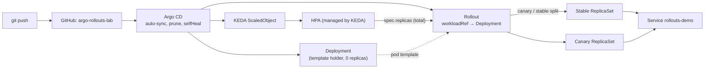

# Argo Rollouts Lab

**Migrating Kubernetes Deployments to Argo Rollouts with zero downtime, and what really happens when KEDA autoscales a Rollout in the middle of a canary.**

A step-by-step, measured lab. Every step is a Git tag, every claim has an observations file with real numbers, and every change is deployed the GitOps way: push to Git, Argo CD syncs.


---

## Results at a glance

### 1. Deployment → Rollout migration (same conditions: 4 replicas, 15s readiness warm-up)

| | Naive `kind` swap | `PruneLast=true` | `workloadRef` (progressive) |
|---|---|---|---|
| Outage window | **~12s, zero ready endpoints** | none | none |
| Failed requests | 24 / 2,097 | 0 / 3,026 | 0 / 2,248 |
| Peak pod count | ~4 (gap) | 8 (full overlap) | ~5 (gradual) |
| Handover | Delete + create | All at once, after healthy | One pod at a time |
| Old workload after | Deleted | Deleted | Kept at 0 replicas |
| Rollback | Another outage | Another swap | Scale Deployment up, then remove Rollout |
| Mechanism | – | Argo CD sync ordering | Built into Argo Rollouts |

**Recommendation:** `workloadRef` with `scaleDown: progressively` for production. Gradual handover, low peak capacity, and the Deployment stays as an instant rollback target.

### 2. KEDA + Rollouts: the autoscaling ambiguity

**KEDA owns the total. The Rollout owns the split.**

| Finding | Evidence |
|---|---|
| The canary weight is a percentage of a *moving* total | At 25%: 1 canary at total 2 and 4, 2 at total 8, 3 at total 10 |
| A bad canary gets multiplied by the autoscaler | A CPU-regressed canary with **zero real traffic** drove KEDA from 2 → 10 replicas in **60s**; bad pods grew 1 → 3; pinned at max (110–126% CPU) until abort |
| Nothing stops it on its own | CPU throttling doesn't restart containers. It stayed at max until a manual abort; back to 2 replicas **72s** later |
| Pod-based splits overshoot the total | Both sides round up: **3 pods at total=2**, **11 pods at total=10**. `maxReplicaCount` is not a hard pod ceiling during a canary |
| KEDA pause deletes the HPA | With `autoscaling.keda.sh/paused-replicas` set, the HPA disappears; KEDA recreates it on unpause |

---

## Architecture



## Environment

- k3d cluster `homelab` (1 server, 2 agents), k3s v1.35
- Argo CD (existing), Argo Rollouts and KEDA installed via Argo CD Applications from Helm charts
- metrics-server (bundled with k3s), Traefik (bundled, for future traffic-router steps)
- App: [`argoproj/rollouts-demo`](https://github.com/argoproj/rollouts-demo) (blue / yellow / red / orange / purple images)
- Measurement: an in-cluster `curl` probe against the Service every 200ms with a 1s timeout. No `port-forward`, since it pins to one pod and hides real behaviour

## Repository layout

```
argo-rollouts-lab/
├── apps/rollouts-demo/
│   ├── app.yaml              # Deployment (template holder) + Service
│   ├── rollout.yaml          # Rollout with workloadRef + canary steps
│   └── scaledobject.yaml     # KEDA ScaledObject targeting the Rollout
├── argocd/
│   └── rollouts-demo-app.yaml   # Argo CD Application (PruneLast, ignoreDifferences)
├── platform/
│   ├── argo-rollouts.yaml    # Argo Rollouts controller + dashboard (Helm via Argo CD)
│   └── keda.yaml             # KEDA (Helm via Argo CD)
└── docs/
    ├── rollout-anatomy.yaml  # annotated Rollout spec (study only, not deployed)
    ├── step3-observations.md
    ├── step4a-observations.md
    ├── step4b-observations.md
    ├── step5a-observations.md
    ├── step6-observations.md
    ├── step6b-observations.md
    ├── step6b-raw.log        # 10s logger: total / stable / canary / HPA CPU
    └── step6b-top.txt
```

## Steps

Check out any tag to see the repo exactly as it was at that step: `git checkout step-4b`.

| Tag | Step | What it shows | Notes |
|---|---|---|---|
| `step-1` | Baseline | Plain Deployment + Service managed by Argo CD | – |
| `step-2` | Install Argo Rollouts | Controller via Argo CD, CRDs, kubectl plugin, anatomy of a Rollout | [rollout-anatomy.yaml](docs/rollout-anatomy.yaml) |
| `step-3` | Naive migration | `kind: Deployment` → `kind: Rollout` in Git: Argo CD prunes the Deployment, Rollout starts from scratch, first revision skips canary steps → **~12s outage** | [observations](docs/step3-observations.md) |
| `step-4a` | `PruneLast=true` | Argo CD prunes only after the new workload is healthy → **0 failures**, but 2x capacity and no fallback | [observations](docs/step4a-observations.md) |
| `step-4b` | `workloadRef` | Rollout references the Deployment, scales it down progressively → **0 failures**, Deployment kept as rollback target | [observations](docs/step4b-observations.md) |
| `step-5a` | Canary + abort drill | Manual canary (25% → pause → 50% → 75%), abort of a bad version, Git revert as the real rollback | [observations](docs/step5a-observations.md) |
| `step-6` | KEDA scaling a Rollout | ScaledObject targets the Rollout via `/scale`; 2 → 10 → 2 under load; Argo CD stays Synced | [observations](docs/step6-observations.md) |
| `step-6b` | Autoscaling during a canary | Canary count vs total; CPU-regressed canary multiplied by KEDA; round-up surge; HPA removed while paused | [observations](docs/step6b-observations.md) |

## Gotchas learned

**Migration**
- A naive `kind` swap is an unprotected rollout: the Rollout's first revision skips all canary steps
- Rolling back a naive migration is a second outage
- Never combine the migration with an image change

**GitOps**
- Argo CD `selfHeal` fights any controller that changes `spec.replicas` (Rollouts on the Deployment, KEDA on the Rollout). Fix: `ignoreDifferences` on `/spec/replicas` plus `RespectIgnoreDifferences=true`
- Deleting `replicas` from the manifest is a trap: apply resets it to **1**
- Rollback order for `workloadRef`: scale the Deployment up **first**, then remove the Rollout, otherwise the ignored replica count leaves it at 0

**Releases**
- After a `workloadRef` migration, releases are made by changing the **Deployment's** image. Developer workflow stays the same
- `kubectl argo rollouts abort` protects production in seconds, but Git still holds the bad version (Degraded). The real rollback is a Git revert
- Reverting to the current stable version is instant: no canary steps
- Without a traffic router, weight = share of pods, and the measured split is approximate (~32% at 1/4 pods over a short sample)

**KEDA**
- Point the ScaledObject at the **Rollout**, never at the template-holder Deployment
- During migration, retarget any existing HPA before the Rollout takes over
- Default HPA scale-down can drop 100% per period (10 → 2 in one step); use `scaleDown.policies` in production
- While metrics-server is unavailable, the HPA can't decide and holds the current count

## Mitigations for KEDA + canary

- Automated canary analysis (AnalysisTemplates on canary-specific metrics, by `rollouts-pod-template-hash`) to abort without a human
- A traffic router (Traefik, Istio, Gateway API) with `setCanaryScale`, so the canary pod count is independent of autoscaling and the round-up surge disappears
- Scale on demand signals (RPS, queue depth) rather than pod CPU, so a canary regression can't inflate the scaling signal
- `autoscaling.keda.sh/paused-replicas` for high-risk releases

## Reproduce

```bash
# prerequisites: a k3d/kind cluster with Argo CD, kubectl, helm, kubectl-argo-rollouts plugin
kubectl apply -f platform/argo-rollouts.yaml
kubectl apply -f platform/keda.yaml
kubectl apply -f argocd/rollouts-demo-app.yaml

# probe (status codes)
kubectl -n demo run probe --image=curlimages/curl --restart=Never -- \
  sh -c 'while true; do c=$(curl -s -o /dev/null -w "%{http_code}" --max-time 1 http://rollouts-demo/color); echo "$(date +%T) $c"; sleep 0.2; done'

# watch
kubectl argo rollouts get rollout rollouts-demo -n demo -w
kubectl -n demo get hpa -w
```

Update `repoURL` in `argocd/rollouts-demo-app.yaml` to your fork, and pin `targetRevision` in the `platform/` Applications to current chart versions.

## Roadmap

- [ ] Automated analysis with Prometheus AnalysisTemplates (error rate, p95 latency per canary)
- [ ] Exact traffic splitting with Traefik + `setCanaryScale` / `dynamicStableScale`
- [ ] Re-run step 6b with analysis enabled: does the bad canary abort itself before KEDA multiplies it?
- [ ] Kargo for multi-stage promotion, reusing the same AnalysisTemplates

---

Built by [Praveen Bhat](https://github.com/praveenbhatk8s) · [LinkedIn](https://www.linkedin.com/in/praveen-bhat-99923111)
